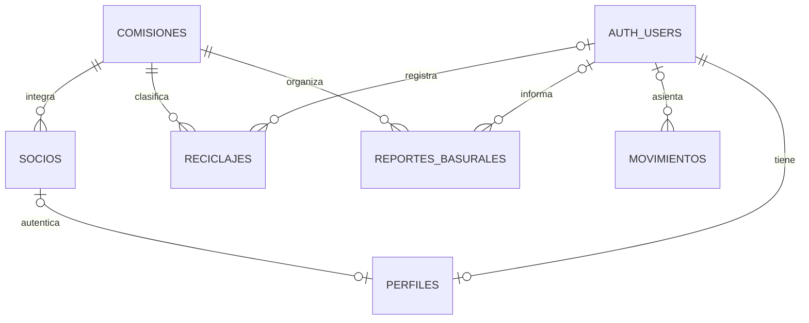

# PreCoop: reciclado escolar

Aplicación educativa para acompañar a una precooperativa escolar. Permite consultar indicadores, registrar reciclajes y reportes de basurales, administrar el padrón y llevar un registro de ingresos/egresos. No reemplaza los libros, comprobantes ni actas oficiales requeridos por el reglamento.

## Historias de usuario, pantallas y supuestos iniciales

### Historias de usuario derivadas

- **Socio/a estudiante:** quiero registrar y consultar materiales recuperados y reportar un punto con basura para participar de las campañas.
- **Consejo de Administración:** quiero administrar el padrón, corregir registros de actividad, dar de baja conservando el historial y registrar movimientos para rendir cuentas.
- **Sindicatura:** quiero consultar el padrón, los indicadores y el libro contable para controlar e informar a la asamblea; no debo editar ni anular asientos.
- **Docente guía/directivo:** quiero consultar resultados y reportes para orientar a la comunidad sin gestionar la precooperativa.
- **Vecino/a:** quiero reportar un basural del entorno escolar y consultar el estado de ese aviso.
- **Asamblea:** quiere conocer indicadores y movimientos para deliberar. La votación y las actas firmadas quedan fuera de esta primera versión.

### Pantallas y recorrido

1. **Ingresar** (`/ingresar`): solo se habilita con Supabase; en modo demo no se necesita cuenta.
2. **Resumen** (`/`): kilos del mes, socios activos, avisos por atender y, solo para Consejo/Sindicatura, saldo de movimientos vigentes.
3. **Reciclaje** (`/reciclaje`): buscar/filtrar y registrar papel, cartón, plástico o latas; Consejo puede modificar y anular, socios pueden registrar.
4. **Socios** (`/socios`): buscar y filtrar padrón por comisión/estado; Consejo registra, modifica y gestiona bajas.
5. **Reportes del terreno** (`/reportes`): cualquier participante habilitado registra un aviso; Consejo actualiza el estado y lo cierra.
6. **Ingresos y egresos** (`/movimientos`): Consejo asienta movimientos y los anula; Sindicatura consulta. Un gasto requiere referencia de comprobante.

**Recorrido propuesto:** ingresar (en modo Supabase) → resumen → registrar reciclaje o informar un punto → Consejo actualiza estado/gestiona padrón → Consejo registra movimientos → Sindicatura consulta el libro.

### Datos de prueba

Los registros están inventados y no contienen datos de personas reales. Se incluyen once nombres ficticios de socios (diez activos, uno con baja), seis comisiones, reciclajes de los cuatro tipos, reportes con distintos estados y movimientos de ejemplo.

## Supuestos explícitos

- **[SUPUESTO]** Los participantes que reportan desde Supabase tienen una cuenta creada por una persona administradora. El documento no define si los reportes deben ser públicos o anónimos.
- **[SUPUESTO]** La foto se representa por un enlace web opcional. No se inventa una solución de almacenamiento ni un mapa porque no se definieron proveedor, coordenadas ni permisos de publicación.
- **[SUPUESTO]** Los estados de reporte (`pendiente`, `en_revision`, `resuelto`, `cerrado`) y de los asientos (`vigente`, `anulado`) son estados operativos de la aplicación, no una regla adicional del reglamento.
- **[SUPUESTO]** El nombre y código de socio de la demo son ficticios. El prototipo no pide correo, teléfono, domicilio ni otros datos de contacto.
- **[SUPUESTO]** Se guardan importes numéricos sin moneda ni símbolo porque el documento no especifica moneda.
- **[SUPUESTO]** Las comisiones se asignan a registros para facilitar la búsqueda; no se infieren autoridades ni facultades particulares de cada comisión.
- **[SUPUESTO]** El Consejo confirma en pantalla que escuchó a la persona antes de registrar una baja. La app conserva esa constancia booleana, sin guardar detalles personales de la audiencia.

## 1. Selección del MVP

**Incluido:** resumen de indicadores definidos; altas, consultas y modificaciones de reciclajes/reportes/socios; filtros; bajas lógicas; asientos de ingresos y egresos con comprobante requerido para gastos y anulación; autenticación y RLS al configurar Supabase.

**Fuera del MVP:** actas con firma, asamblea/votaciones, campañas y pedidos municipales, respuesta del municipio, mapa interactivo, carga de fotografías y adjuntos reales, notificaciones y administración de cestos como entidad independiente. Se priorizan las funciones que permiten cargar y consultar la actividad cotidiana; el documento no define flujos, formatos ni servicios externos para las funciones excluidas. La aplicación no reemplaza actas firmadas, comprobantes ni libros oficiales.

## 2. Proyecto y estructura

Proyecto Vue 3 + Vite; Vue Router gestiona las vistas y el estado compartido usa un módulo reactivo simple (sin Pinia). El modo demo usa `localStorage`; con variables de entorno completas, la fuente de datos pasa a Supabase.

```text
basupreco/
├── database/
│   ├── schema.sql
│   └── seed.sql
├── src/
│   ├── assets/
│   │   ├── base.css
│   │   └── main.css
│   ├── data/
│   │   └── demo.js
│   ├── lib/
│   │   └── supabase.js
│   ├── router/
│   │   └── index.js
│   ├── stores/
│   │   └── app.js
│   ├── utils/
│   │   └── validation.js
│   ├── views/
│   │   ├── DashboardView.vue
│   │   ├── LoginView.vue
│   │   └── RecordsView.vue
│   ├── App.vue
│   └── main.js
├── .env.example
├── .gitignore
├── index.html
├── package.json
└── vite.config.js
```

## 3. Pantallas principales

Las rutas muestran el resumen, los cuatro listados y el ingreso. `RecordsView.vue` comparte tablas, filtros, formularios, validación y operaciones entre los cuatro dominios; sus definiciones de columnas/campos difieren por registro. El recorrido se detalla arriba.

## 4. Navegación y roles

Vue Router oculta rutas no autorizadas y la navegación solo ofrece opciones permitidas. En modo demo están **simulados** Consejo de Administración, Sindicatura, socio/a, docente guía y vecino/a: el selector solo sirve para probar la interfaz, no autentica ni protege información. En Supabase el rol se obtiene de `perfiles`; la seguridad efectiva está en PostgreSQL/RLS, no en los botones.

## 5. Formularios y validaciones

`src/utils/validation.js` valida campos requeridos, fechas ISO reales, kilos mayores que cero, cantidades enteras, residuo/frecuencia/estados permitidos, importes positivos, URL de foto y comprobante obligatorio si el movimiento es un egreso. Las restricciones se repiten en PostgreSQL (`CHECK`, claves foráneas y triggers), para que no dependan del navegador.

## 6. Datos ficticios

En demo, un aviso superior **“Datos de prueba”** identifica los ejemplos; cambios de prueba persisten en el almacenamiento local del navegador. `src/data/demo.js` contiene fixtures inventados. `database/seed.sql` carga equivalentes en Supabase.

## 7. Diseño responsive

Los estilos son mobile-first con navegación plegable, formularios adaptables, tablas con desplazamiento horizontal, foco visible, contraste y controles de al menos 44 px en pantallas pequeñas. Ver `src/assets/base.css` y `src/assets/main.css`.

## 8. Alta, consulta, modificación y baja/anulación

- **Socios:** alta y edición; la baja es lógica, exige confirmar que la persona fue escuchada y guarda fecha/constancia. Un trigger impide bajar de nueve socios activos.
- **Reciclajes:** alta y edición; la anulación conserva el registro y lo excluye de indicadores.
- **Reportes:** alta y edición; el cierre conserva el aviso en el historial.
- **Movimientos:** se crean y consultan; no se reescriben porque eso alteraría el libro diario. Se anulan conservando el asiento original; la corrección debe asentarse como un nuevo movimiento. Un trigger PostgreSQL impide cambios distintos de la anulación.
- **Borrado físico:** la interfaz no lo ofrece y los permisos SQL no conceden `DELETE`.

## 9. Búsqueda, filtros y estados

Los listados permiten búsqueda de texto, filtro por tipo de residuo, comisión, mes, estado de socio, terreno, reporte y movimiento. Los registros tienen estados visibles y el tablero calcula kilos del mes, socios activos, reportes pendientes/en revisión y saldo de movimientos vigentes. Los filtros se aplican localmente sobre los datos cargados; para el tamaño esperado de una precooperativa es suficiente para el prototipo.

## 10. Persistencia y datos compartidos

| Información | Modo demo | Supabase configurado |
|---|---|---|
| Registros de socios, reciclajes, reportes y movimientos | `localStorage` del navegador actual | PostgreSQL, compartido entre cuentas/dispositivos según RLS |
| Comisiones | Fixtures locales | Tabla PostgreSQL |
| Rol seleccionado | `localStorage`; solo simulación | Tabla `perfiles`, asignada a la cuenta autenticada |
| Sesión | No hay sesión real | Supabase Auth |
| Filtros, modal abierto, mensajes | Solo memoria mientras la vista está abierta | Solo memoria mientras la vista está abierta |
| Esquema y datos de prueba iniciales | Código fuente | `database/schema.sql` y `database/seed.sql` |

## 11. Necesidad de backend y transición

El modo demo no necesita backend: almacena todo en `localStorage`. Sus límites son importantes: no sincroniza dispositivos ni usuarios, puede borrarse desde el navegador y no protege los datos. Como la app debe compartir información entre socios y conservar el libro, el destino necesita backend. La transición ya está implementada: al definir `VITE_SUPABASE_URL` y `VITE_SUPABASE_ANON_KEY`, autenticación, consultas y escrituras usan Supabase; no se copian automáticamente los datos locales al servidor. En ese modo se usa PostgreSQL + Auth + RLS.

## 12. Modelo de datos y relaciones

Las claves primarias son UUID; las relaciones de comisión y socio son claves foráneas. `created_by` vincula registros enviados con Auth. No se guardan datos de contacto.



Tablas: `comisiones`, `socios`, `perfiles`, `reciclajes`, `reportes_basurales`, `movimientos`. El diseño completo, checks, índices y referencias están en `database/schema.sql`.

## 13. Scripts reproducibles

- `database/schema.sql`: tablas, relaciones, validaciones, funciones de rol, triggers y políticas RLS.
- `database/seed.sql`: comisiones y registros ficticios; no crea usuarios ni contraseñas.

## 14. Conexión Vue–Supabase

`src/lib/supabase.js` crea el cliente con URL/anon key pública de entorno. `src/stores/app.js` consulta y modifica PostgreSQL si hay sesión; en caso contrario, se usa el modo demo **solo si faltan las dos variables**. Un error de Supabase se informa y no se reemplaza silenciosamente por datos locales.

## 15. Autenticación y RLS

El inicio de sesión usa Supabase Auth. Las cuentas se crean en el panel de Supabase; una persona administradora asigna su rol en `perfiles`. No hay registro público ni credenciales de ejemplo. Las políticas en `database/schema.sql` restringen escrituras por rol y datos contables a Consejo/Sindicatura. No se usa `service_role` en el cliente.

Ocultar un botón solo mejora la interfaz: cualquier usuario podría intentar llamar la API por otra vía. RLS evalúa cada consulta/escritura en PostgreSQL y evita leer o cambiar filas sin permiso, aunque se saltee Vue. Los triggers también protegen las invariantes del padrón y del libro contable.

## 16. Carga, confirmación y error

Los formularios muestran “Guardando…” durante escrituras; altas/ediciones/cancelaciones tienen confirmación visible y los fallos muestran un mensaje sin borrar el formulario. La carga inicial tiene estado visible; errores de sesión/consulta también se muestran en la interfaz.

## Configuración y ejecución

Requisitos: Node.js compatible con el proyecto (`package.json`), npm y un proyecto Supabase para el modo compartido.

```sh
npm install
npm run dev
```

Para modo demo, no crees `.env`: se cargan fixtures locales y un selector permite simular roles.

Para Supabase:

1. En el SQL Editor del proyecto, ejecutar `database/schema.sql` y luego `database/seed.sql`.
2. En Authentication, crear/invitar cuentas. En SQL Editor, asignarles un perfil con su UUID de Auth; reemplazar los valores de ejemplo:

   ```sql
   insert into public.perfiles (user_id, rol)
   values ('UUID-DE-AUTH', 'consejo');
   ```

   Roles aceptados: `consejo`, `sindicatura`, `socio`, `docente_guia`, `vecino`. Para vincular una cuenta al padrón, completar `socio_id` con el UUID correspondiente.
3. Copiar `.env.example` como `.env` y completar solo la URL del proyecto y la **anon/public key**. Nunca usar ni publicar `service_role`.
4. Reiniciar Vite con `npm run dev`. La presencia de ambas variables selecciona Supabase; las cuentas sin perfil no pueden acceder a datos.

## Limitaciones conocidas

- Los roles seleccionables del modo demo no son control de acceso.
- No se migran datos de `localStorage` a Supabase.
- Las fotos son URL, sin carga/almacenamiento de archivos; no hay mapa ni coordenadas.
- No hay flujos de asamblea, actas firmadas, votaciones, medidas disciplinarias, pedidos/respuestas municipales, ni gestión detallada de cestos.
- No se automatizan el cierre contable del 31 de octubre ni la convocatoria anual de noviembre; son obligaciones organizativas que requieren definición funcional y actas.
- La referencia de comprobante es texto; el original debe conservarse fuera de esta app.
- Los datos de demo son ejemplos pedagógicos, no movimientos o mediciones reales.
